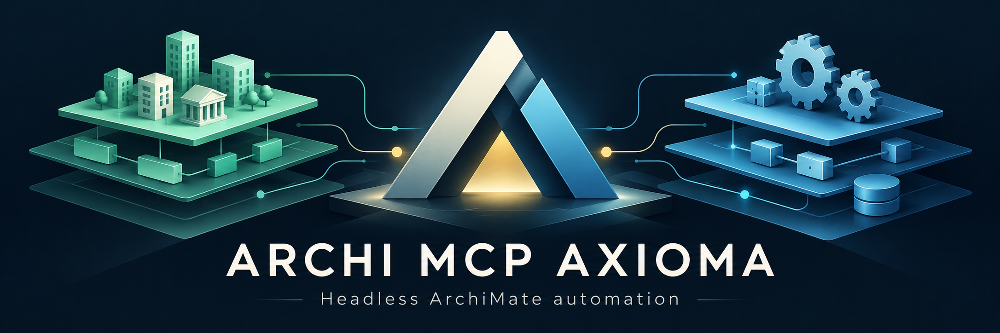

# Archi MCP Axioma

**Model your architecture. Automate the work. Keep the workbench optional.**

An open-source [Model Context Protocol](https://modelcontextprotocol.io/) server
for creating, editing, validating, and exporting native
[Archi](https://www.archimatetool.com/) models without opening the workbench.
Use explicit model IDs, commit validated transactions, and optionally watch
the results update inside Archi.

**Early development: 0.1.0** · **MIT license** · **MCP over stdio**

[Quick start](#quick-start) · [Capabilities](#what-you-can-do) ·
[Live updates](#see-changes-live-in-archi) · [Documentation](docs/README.md) ·
[Issues](https://github.com/h0w4r/archi-mcp-axioma/issues)

> **Verified environment:** Windows, Archi 5.10.0, and Java 21. The headless
> server and optional Live companion have been exercised through real MCP
> processes, native files, and actual Archi editors. Other environments are
> not yet operationally verified.

## Why Axioma?

- **No workbench dependency.** Create, edit, and save without opening Archi or
  approving a change in its GUI.
- **More than one model.** Each request targets an explicit `modelId`, not
  whichever model happens to be selected in an editor.
- **Native files, not a parallel format.** Read and write Archi models through
  Archi's own model and archive APIs.
- **Changes you can account for.** Atomic batches, validation, local history,
  optimistic concurrency checks, and correlated errors.
- **A GUI when you want one.** The optional Live companion refreshes already-open
  views without making the MCP server depend on them.

## What you can do

| Capability | Included |
| --- | --- |
| Model lifecycle | Create, open, inspect, validate, save, reload, and close multiple models |
| ArchiMate concepts | All 61 concrete element types and 11 relationship types exposed by the tested metamodel |
| Views and presentation | Elements, connections, groups, notes, lines, view references, images, and native visual attributes |
| Model organization | Folders, properties, documentation, and specializations |
| Transactional editing | Atomic batches, aliases, `dryRun`, revision checks, and file fingerprints |
| Recovery | Local content-addressed history and restoration with embedded images preserved |
| Layout and export | ELK layout/routing and transparent SVG/PNG export |
| Optional live viewing | Refresh clean models already open in Archi; pause when unsaved human edits conflict |

Native relationship rules still apply. Axioma does not bypass the metamodel
to manufacture invalid diagrams. See the [tool reference](docs/headless-tools.md)
and [operational limits](docs/headless-operations.md#current-limits).

## Choose your workflow

| Component | Purpose | Open Archi required? |
| --- | --- | --- |
| **Axioma headless server** | Your MCP client models and exports through stdio | **No** |
| **Axioma Live** | Optional companion for seeing saved changes in open editors | Yes, only for viewing |
| **jArchi** | Your existing scripting workflows, if installed | Not an Axioma dependency |
| **Legacy GUI/HTTP server** | Original upstream implementation, retained separately | See [legacy documentation](README-LEGADO.md) |

Already have **jArchi** installed? You can keep it for your scripts. Axioma
calls Archi's native APIs directly; it does not need jArchi to be installed,
running, or used as a bridge. jArchi is not the Live companion.

## Quick start

### 1. Build and prepare

Install Archi 5.10.0, PowerShell 7, and a JDK 21. Point `JAVA_HOME` at the JDK,
then run these commands in **PowerShell 7**:

```powershell
git clone https://github.com/h0w4r/archi-mcp-axioma.git
Set-Location archi-mcp-axioma
./tools/build-headless.ps1 -ArchiHome 'C:/Program Files/Archi'
./tools/prepare-headless.ps1 -ArchiHome 'C:/Program Files/Archi'
```

Preparation creates an **isolated runtime** under `build/runtime/Archi`.
It does not install Axioma into your existing Archi installation. Keep this
checkout and its generated bundle at stable paths after preparation.

Have a compiled ZIP instead? Follow the
[compiled-package instructions](headless/PAQUETE.md).

### 2. Connect your MCP client

Adapt the paths below to your checkout and model workspace. Your client starts
the process; there is no HTTP endpoint or server window to open.

```json
{
  "mcpServers": {
    "archi-mcp-axioma": {
      "command": "pwsh",
      "args": [
        "-NoProfile", "-File",
        "C:/projects/archi-mcp-axioma/tools/start-headless.ps1",
        "-Workspace", "C:/models/architecture"
      ]
    }
  }
}
```

This is a generic configuration example. Adapt its surrounding structure to
your client's configuration format. Models, imported images, and exports must
remain within the selected workspace.

### 3. Try your first model

Ask your MCP client:

> Check the Axioma runtime. Create a model named "Architecture Sandbox" at
> "sandbox.archimate". Add a business actor and a business process, connect them
> using a valid relationship, and place them in a view. Validate the model and
> export the view as a transparent SVG. Use the returned model and object IDs.

Successful mutations are saved automatically. Look for `persisted: true`,
`revision`, and `fingerprint` in the response. The
[getting-started guide](docs/headless-getting-started.md) explains verification,
paths, and the first calls in detail.

## See changes live in Archi

Install the optional **Axioma Live** `.archiplugin`, open the same native model
file in Archi, and enable live updates from the **Axioma** menu.

- Saved changes update the existing model, view, and editor instances.
- Zoom is retained; selection and viewport are restored where the new content
  allows it.
- Unsaved human changes pause synchronization for that model. Other clean
  models can continue updating.
- Closing Archi does not stop the headless server.

Live is **off by default** and does not automatically merge simultaneous human
edits. Read the [Live installation and conflict guide](live/README.md) before
enabling it.

## Documentation

| I want to... | Read |
| --- | --- |
| Find the right guide | [Documentation hub](docs/README.md) |
| Install, configure, and verify the server | [Getting started](docs/headless-getting-started.md) |
| Learn the nine tools and use atomic batches | [Tool reference](docs/headless-tools.md) |
| Understand saving, conflicts, history, and limits | [Operations and model safety](docs/headless-operations.md) |
| Install or troubleshoot live viewing | [Axioma Live](live/README.md) |
| Understand the implementation boundaries | [Headless architecture](docs/headless-architecture.md) |
| Build, test, and package from source | [Development guide](docs/headless-development.md) |
| Review dependencies and attribution | [Dependencies](headless/DEPENDENCIAS.md) · [License](LICENSE) |

## Status and boundaries

This is an **initial development release**, not a claim of compatibility with
every Archi version, operating system, MCP client, or third-party extension.

- Editing and persistence do not start a workbench. Export still uses SWT and
  installed fonts; Linux/Xvfb operation has not been verified.
- The server uses **stdio**, not the legacy HTTP tool/resource contract.
- File conflict checks do not lock the Save button in other applications.
- Local history is not an off-machine backup, and uncertain requests must not
  be blindly replayed.

See [operations](docs/headless-operations.md), [changelog](CHANGELOG.md), and
[security reporting](SECURITY.md) for details.

## Built on open-source foundations

Axioma is a fork of [fanievh/archi-mcp-server](https://github.com/fanievh/archi-mcp-server)
by JS van Heerden. It preserves upstream history, attribution, and the MIT
license, and selectively reuses the original geometry/layout implementation.
Archi and bundled dependencies retain their own licenses and notices.

[Explore the source](https://github.com/h0w4r/archi-mcp-axioma) ·
[Report an issue](https://github.com/h0w4r/archi-mcp-axioma/issues) ·
[Back to top](#archi-mcp-axioma)
